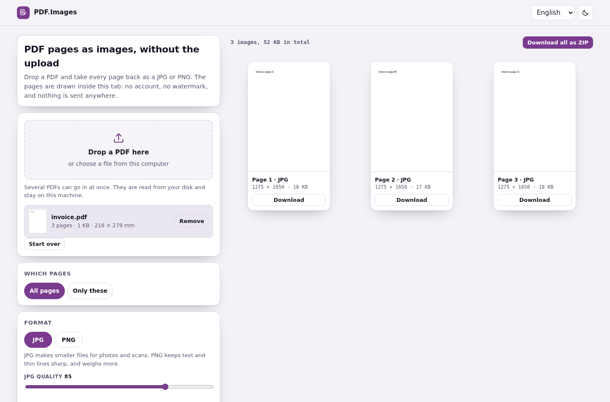

# PDF to Images

**Every page as a JPG or PNG, made inside the tab.**

[](https://tekideki.github.io/PDF-to-Images/)
[](LICENSE)



Drop a PDF, pick the format and the resolution, press the button. Every page comes back as its own image, ready to download one at a time or as a single ZIP.

The pages are drawn by the browser. No account, no watermark, no page counter, and nothing is uploaded.

## What it does

- **JPG or PNG.** JPG for scans and photos, where the file has to be small. PNG for text and thin lines, where sharp edges matter.
- **72, 150 or 300 dots per inch.** The size in pixels is stated before the button is pressed, so nobody has to guess what 300 dpi means for their page.
- **A page list.** All pages, or `1-3, 7, 10-12`. A list that does not describe real pages is refused instead of half rendered.
- **Several files at once.** Cards say which PDF a page came from, and two files never write the same name.
- **One ZIP for the lot.** Built in the page, with a proper central directory, so the archive opens in any tool.
- **Locked PDFs.** A password box, used once, in this tab.
- **Four languages.** English, Romanian, Serbian Latin and Serbian Cyrillic, with the counting done the way each language counts.
- **Dark theme, installable, offline.** One HTML file holds the whole thing, including the renderer.

## How to use it

1. Drop a PDF on the page, or choose it from the disk.
2. Pick JPG or PNG, and 72, 150 or 300 dpi.
3. If you only want some pages, choose **Only these** and type the list.
4. Press **Turn into images**.
5. Take a page with **Download**, or the whole set with **Download all as ZIP**.

## Why it is built this way

**Nothing leaves the tab.** PDF.js, the renderer used by Firefox, ships inside the page. It is inlined as text and turned into a blob URL when a PDF is opened, so there is no CDN request, no server, and no queue. The browser test fails if any request leaves the local server.

**No third party service, one third party library.** The renderer is the only code in here that is not written for this project. It is Apache 2.0, copied unmodified, credited in `NOTICE`, and its licence travels with it in `vendor/LICENSE-pdfjs.txt`.

**The output is checked against another renderer.** `tests/fixtures/expected-invoice-72.png` was drawn by pypdfium2 from the same fixture PDF, and the browser test compares our page against it. Two renderers antialias differently, so the test asks that at most a fiftieth of the pixels differ strongly and that the average difference stays small.

**Deterministic build.** `python3 build.py` inlines the styles, the model, the messages and both pdf.js files into `index.html`, and transliterates Serbian Cyrillic so it cannot drift from the Latin version. No timestamps, no machine paths, no em dash, no byte order mark; the build refuses all of them.

**One honest limit.** The page is a picture of the page, not its text. A PDF that was a scan comes out exactly as unsearchable as it went in. If you need the words, that is a different job.

## Tests

```bash
node tests/logic_test.cjs          # 63 checks: page lists, pixels, names, zip
python3 tests/ui_test.py           # 53 checks in Chromium, server included
```

The logic test writes the ZIP to a temporary folder and reads it back with `unzip`, so the archive is checked by a tool that is not ours. The browser test compares a rendered page with the pypdfium2 reference, drives the password box, the page list and the settings, and fails on any console error or foreign request.

## Development

```bash
python3 build.py                   # writes index.html from src/
python3 -m http.server 8000        # then open http://localhost:8000
```

Sources live in `src/`: `model.js` (page lists, pixels, names, zip), `app.js` (page), `styles.css`, `template.html`, `i18n/locales.json` (en, ro, sr-latn). The renderer is in `vendor/`.

The build needs `unzip` on the machine that runs the logic test, and pypdfium2 only to regenerate the reference image.

## Licence

Apache 2.0. See `LICENSE` and `NOTICE`. Every tool here is free and stays free.
